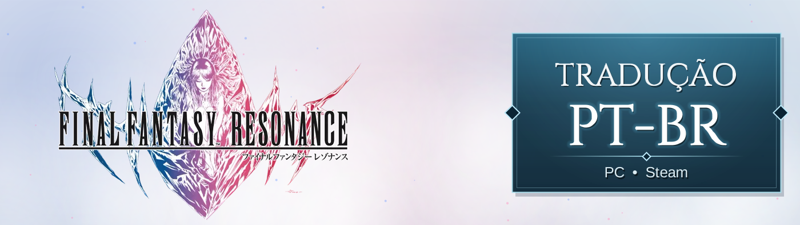
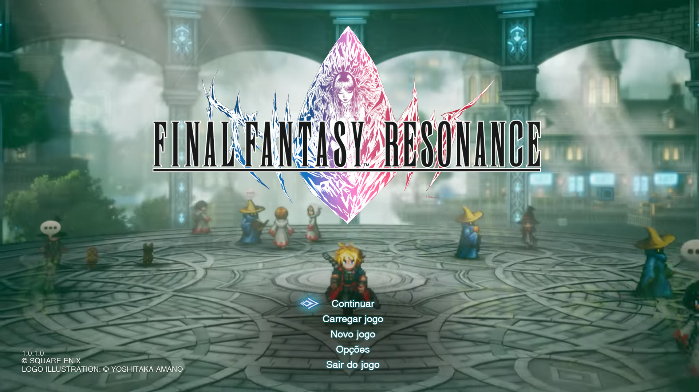
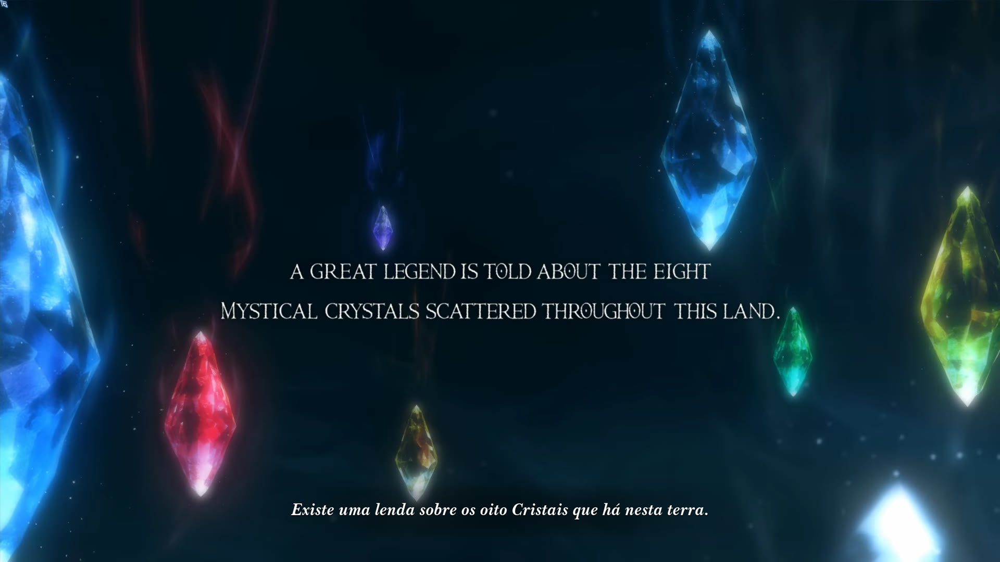
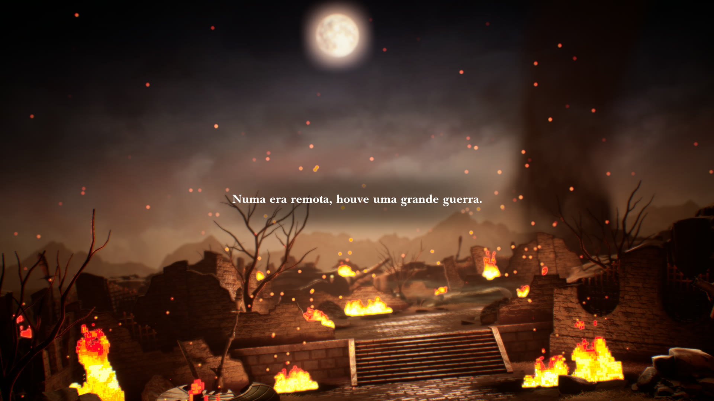
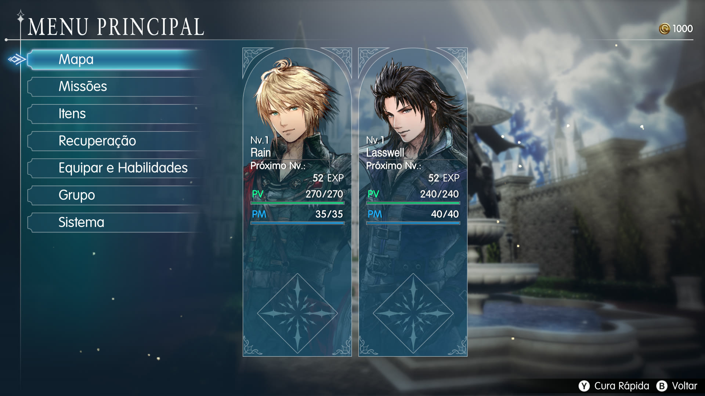
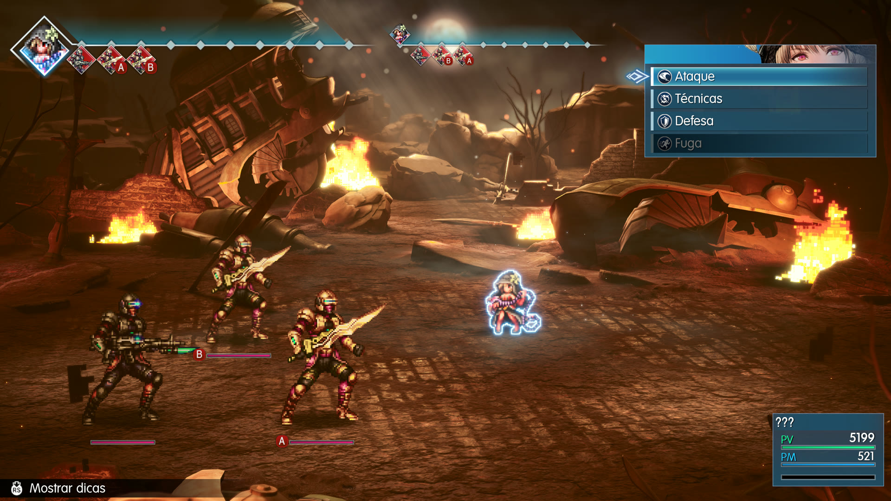
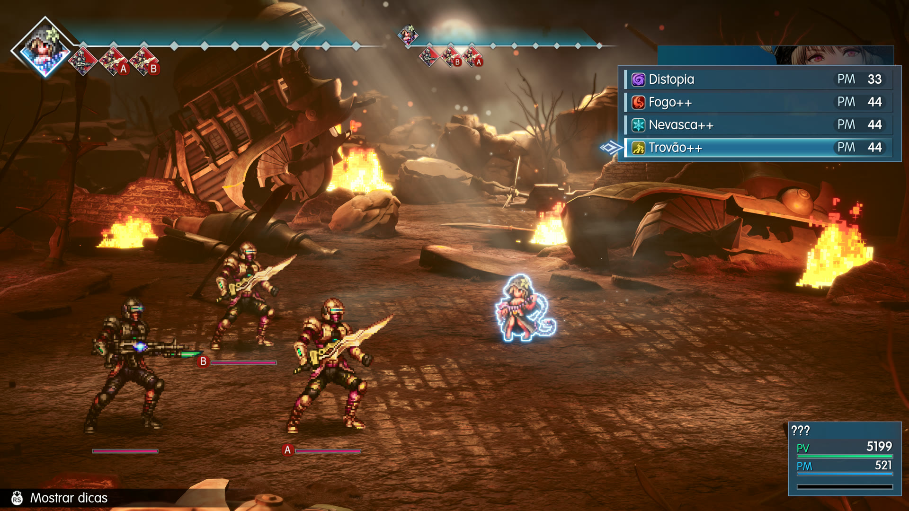

# 💎 Final Fantasy Resonance (PC) — Tradução PT-BR

-009c3b)

Tradução de fã do **Final Fantasy Resonance** (PC, Steam).
**Tradução completa para o português do Brasil**, com menus, história, diálogos, legendas das cenas, magias,
habilidades, itens, monstros, lugares, missões e descrições em português.

*Feita por fãs, para fãs. Gratuita, sem fins lucrativos e sem nenhuma ligação com a Square Enix (veja o aviso legal no
fim desta página).*

> ✅ O jogo inteiro está traduzido. Se achar algum problema, abra uma [issue](../../issues).

## 📸 Fotos

| | |
|---|---|
|  |  |
| Tela de título | Abertura: a narração com legenda em português |
|  |  |
| Narração da abertura | Menu principal |
|  |  |
| Comandos da batalha | Magias com os nomes oficiais (Fogo++, Nevasca++, Trovão++) |

## 📥 Download

**[⬇️ Baixar a tradução](../../releases/latest)** (página da versão mais recente). Dentro do zip vêm os 3 arquivos da
tradução (`.pak`, `.utoc` e `.ucas`) e um guia `LEIA-ME.txt`. Como instalar: veja **💾 Instalação** abaixo.

## 🎮 O que foi traduzido

| Parte | Cobertura |
|---|---|
| História completa, cenas, legendas das cenas em vídeo, conversas do grupo e eventos de personagem | 100% |
| Missões secundárias e extras, diário, lendas das Visões e espers | 100% |
| Menus, opções, batalha, magias, habilidades, itens, equipamentos, monstros e lugares | 100% |
| Letreiros da batalha (ATORDOADO, ATORDOAMENTO TOTAL, Disparo Arriscado, IGNIÇÃO!) | imagens traduzidas |

São mais de 24 mil textos.

- **Tudo a partir do inglês**, conferido com o japonês, com o contexto da história e de quem está falando em cada fala.
  Quando o inglês faz piada ou trocadilho, a piada foi recriada em português em vez de traduzida ao pé da letra.
- **Feita a partir dos outros Final Fantasy em português:** a base da tradução são os textos oficiais em PT-BR da Square
  Enix (FF VII Rebirth, FF XVI, FF Pixel Remaster I–VI, FF VII Remake e FF XV). Magias, invocações, itens, status, monstros e
  termos da série ficam com os mesmos nomes desses jogos: *Poção, Pena de Fênix, Fogo/Fogo+/Fogo++, Nevasca, Beemote,
  Moogle ("kupo!")*.
- **Cada personagem fala do seu jeito**, com tratamento antigo ("tu", "vós") para quem fala arcaico no inglês.
- **Interface:** PV/PM no lugar de HP/MP e números no padrão brasileiro.

## 🚫 O que não foi traduzido (de propósito)

| O quê | Por quê |
|---|---|
| Nomes próprios (Rain, Lasswell, Fina, Lid, Nichol, Grandshelt, Lapis…) | São nomes, iguais em todas as versões do jogo. |
| Frase do vídeo de abertura ("A GREAT LEGEND IS TOLD…") | Está gravada dentro do vídeo; a narração aparece com legenda em português. |
| Imagens dos tutoriais | São capturas da tela; o texto das dicas está traduzido. |
| Logotipos e créditos finais | Arte, marcas registradas, cargos e nomes da equipe ficam como no original. |
| Vozes | Ficam as vozes originais (japonês ou inglês, como você escolher). |

## 💿 O que você precisa

Você precisa da sua **própria cópia** do **Final Fantasy Resonance** para **PC (Steam)**. **Este projeto não distribui
o jogo.**

## 💾 Instalação

A tradução são 3 arquivos que o jogo carrega **por cima** dos arquivos originais. Nenhum arquivo do jogo é alterado.

1. Copie os 3 arquivos `FFRS-Windows_1_P.pak`, `FFRS-Windows_1_P.utoc` e `FFRS-Windows_1_P.ucas` para a pasta `Paks`
   do jogo:
   `...\steamapps\common\FINAL FANTASY RESONANCE\FFRS\Content\Paks\`
   (na Steam: botão direito no jogo → *Gerenciar* → *Explorar arquivos locais* → `FFRS\Content\Paks`).
2. Abra o jogo e, nas opções, escolha **Português** como idioma do texto (ele aparece no lugar do inglês). As vozes
   podem ficar no idioma que preferir.

- **Os 3 arquivos andam juntos:** sem o `.utoc` e o `.ucas`, o jogo não carrega a tradução.
- **Para atualizar**, troque os 3 arquivos pelos novos. **Para voltar ao inglês**, só apague os 3.
- **Outras traduções:** se houver outros arquivos de tradução na pasta `Paks` (de outra equipe), tire-os antes.

Saves do jogo em inglês funcionam normalmente.

## 🔒 Segurança

- Baixe a tradução **só pela página de [Releases](../../releases) deste repositório**.
- A tradução é só um pacote com os textos e as imagens: **não há executável** nem instalador.

## ❓ Não funcionou?

| Sintoma | Causa provável |
|---|---|
| Continua tudo em inglês / "Português" não aparece | Os 3 arquivos não estão em `FFRS\Content\Paks`, ou falta o `.utoc`/`.ucas`. |
| Textos misturados ou nomes antigos | Há arquivos de outra tradução (ou de uma versão anterior desta) na pasta `Paks`. Deixe só os novos. |
| Algo em inglês depois de uma atualização do jogo | A atualização pode ter mudado os textos. Abra uma issue. |
| Travamento ou tela preta | Abra uma issue informando onde aconteceu. |

## 🐞 Achou um erro?

Abra uma [issue](../../issues/new/choose) usando o formulário "Erro na tradução". Informe a versão do patch, o
capítulo ou lugar e, se puder, mande um print. Toda correção de português também é bem-vinda.

## 🙏 Créditos

- **Tradução, revisão e ferramentas:** [0xdhx0](https://github.com/0xdhx0).
- **Fonte livre** usada nos letreiros da batalha: Liberation Sans (licença OFL).

**Como foi feita:** a tradução usou ferramentas de IA. Todo o texto foi traduzido a partir do inglês com o contexto da
história e o jeito de falar de cada personagem, e testado no jogo. Se achar uma frase estranha, abra uma
[issue](../../issues), porque toda sugestão ajuda.

## ⚖️ Aviso legal e uso

- Esta é uma **tradução feita por fãs, para fãs**, **gratuita** e **sem fins lucrativos**.
- **Não temos nenhuma ligação** com a Square Enix ou qualquer outra empresa envolvida no jogo. O projeto não é oficial,
  nem aprovado ou apoiado por elas.
- *Final Fantasy Resonance* e todos os nomes, marcas e personagens pertencem aos seus donos (© SQUARE ENIX).
- O pacote contém **só os arquivos da tradução** e **não funciona sem o jogo original**. O jogo não é distribuído
  aqui: não peça nem compartilhe cópias do jogo neste repositório.
- Pode usar e compartilhar a tradução à vontade, **de graça**. Ela **não pode ser vendida** nem monetizada. Se alguém
  cobrou por ela, você foi enganado. Veja [LICENSE.txt](LICENSE.txt).
- Se você é detentor de algum direito e quer que algo seja retirado, abra uma issue ou entre em contato pelo GitHub.

Apoie a franquia comprando os jogos oficiais.
